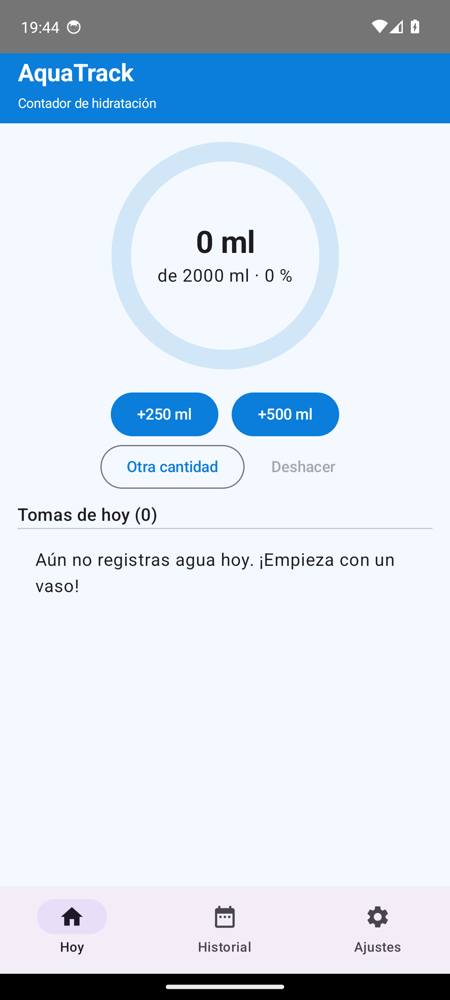
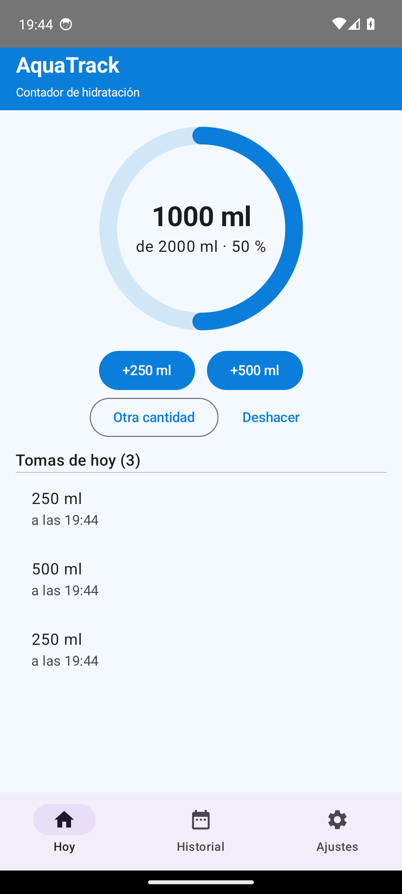
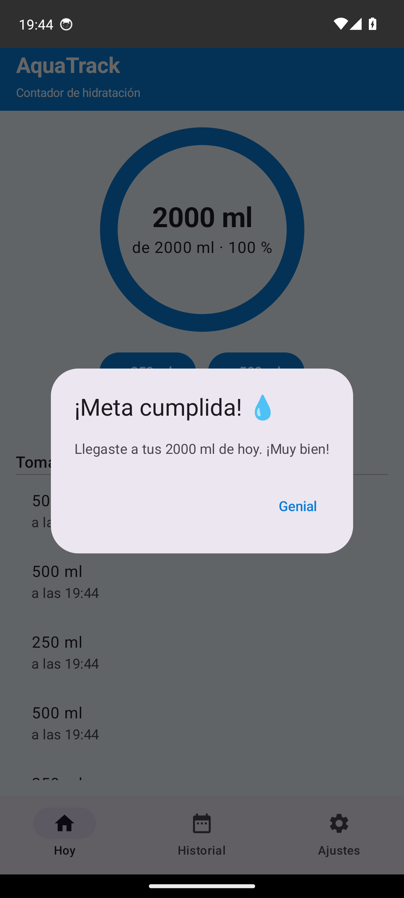
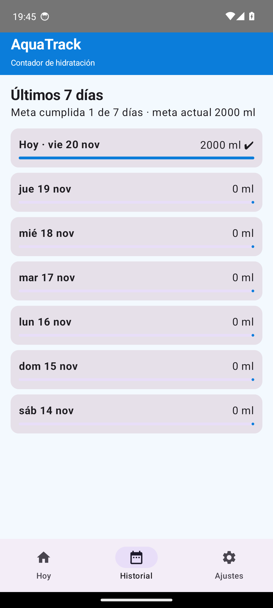
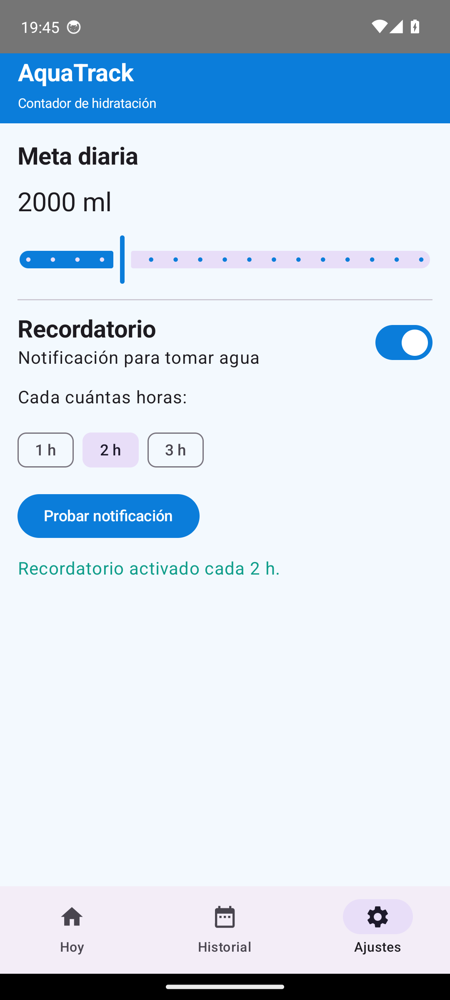
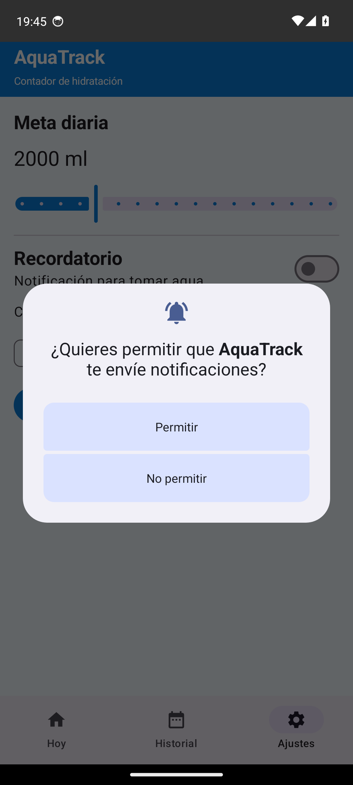
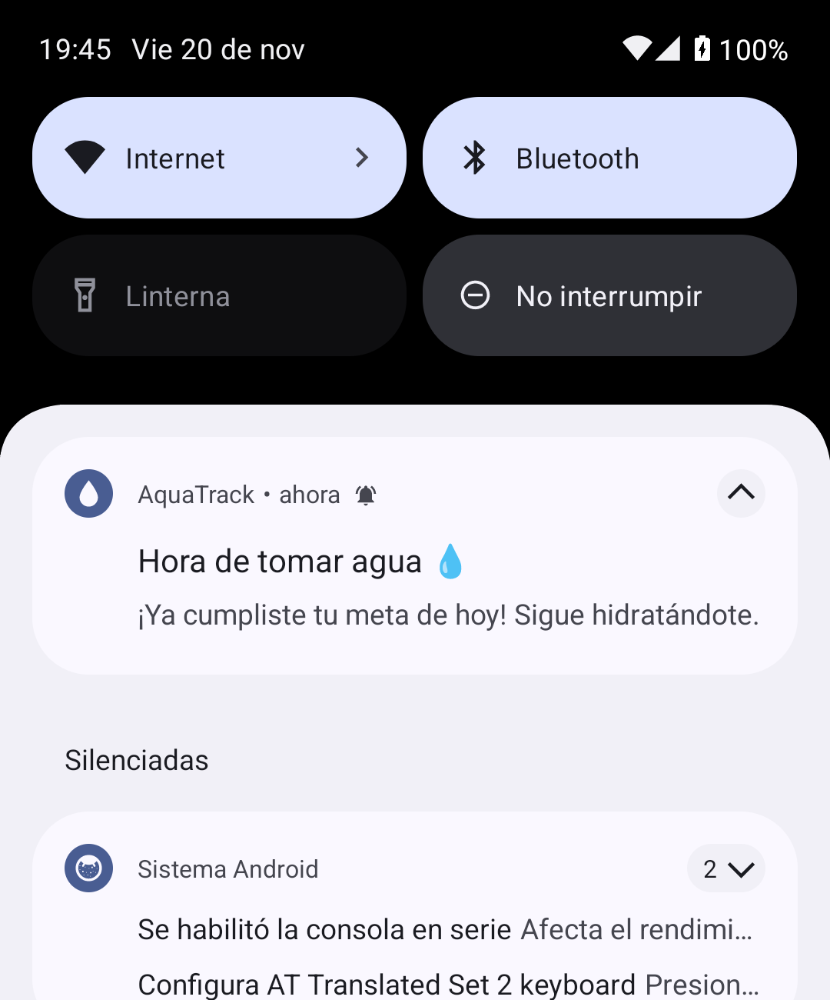
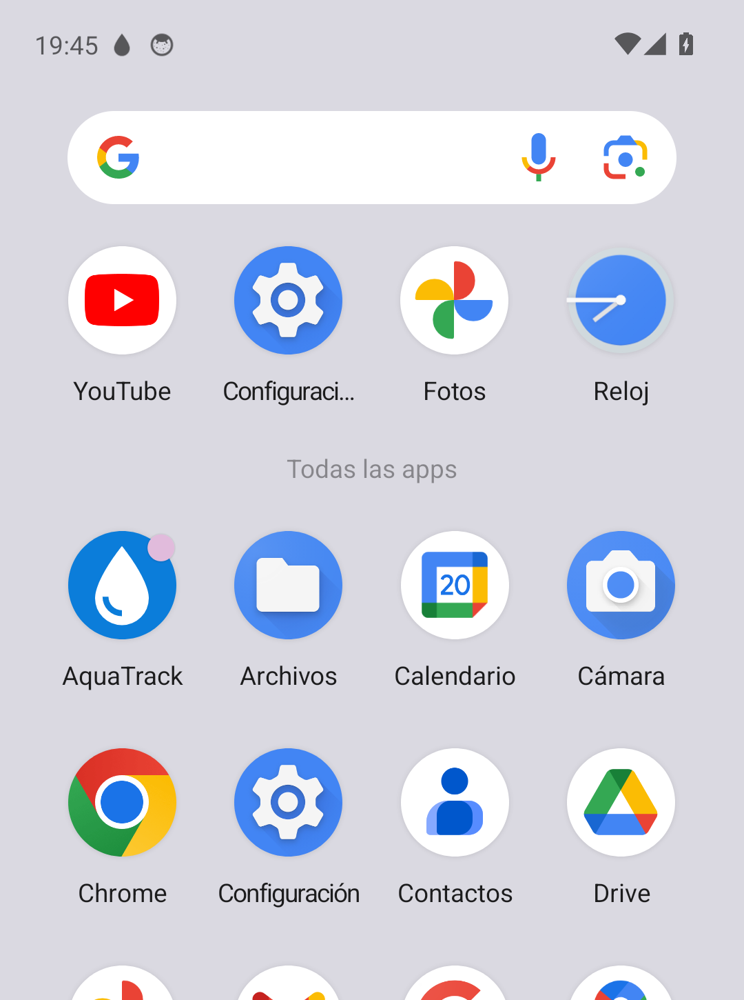

# 💧 AquaTrack — Aplicación nativa Android

App **nativa de Android** para registrar el consumo diario de agua. Está escrita en **Kotlin** con **Jetpack Compose** y usa funciones propias del sistema operativo: notificaciones locales, tareas en segundo plano con WorkManager, vibración y almacenamiento local.

> Subproducto No. 1 · Aplicaciones Web Progresivas · Unidad I
> Universidad Tecnológica de Puebla · Jahir Jaziel Serrano Arana · 10° D

## ⬇️ Descargar
**APK:** https://github.com/JazyelAe/AquaTrack-Nativa/releases/tag/v1.0.0
Descarga `AquaTrack-v1.0.0.apk` en un teléfono con Android 8.0 o superior, ábrelo y permite "instalar apps de origen desconocido".

## Funciones
| | Función |
|---|---|
| ➕ | Registrar 250 ml, 500 ml u otra cantidad (50–2000 ml) y deshacer la última toma |
| 🎯 | Meta diaria configurable (1000–5000 ml) con anillo de progreso |
| 📅 | Historial de los últimos 7 días, guardado en el teléfono |
| 🔔 | Recordatorio cada 1, 2 o 3 horas con notificación local (WorkManager) y botón de prueba |
| 📳 | Vibración y felicitación al cumplir la meta |
| 🌙 | Material 3, modo oscuro del sistema e icono propio |

## ¿Por qué es una app nativa?
- Se programa con el **SDK oficial de Android** (Kotlin + Jetpack) y se compila a un APK que solo corre en Android.
- Usa **APIs del sistema**: `NotificationManager`, permiso en tiempo de ejecución `POST_NOTIFICATIONS`, `WorkManager`, `Vibrator` y `SharedPreferences`.
- Funciona **sin internet** y se instala en el teléfono como cualquier app de tienda.

## Tecnologías
Kotlin 2.0 · Jetpack Compose + Material 3 · WorkManager 2.9 · SharedPreferences · Gradle 8.9 / AGP 8.5 · minSdk 26 (Android 8.0) · GitHub Actions + Releases

## Estructura
```
app/src/main/java/com/jaziel/aquatrack/
├── MainActivity.kt        tema y navegación inferior
├── Almacen.kt             SharedPreferences: tomas por fecha y ajustes
├── PantallaHoy.kt         anillo, botones y lista de tomas
├── PantallaHistorial.kt   últimos 7 días
├── PantallaAjustes.kt     meta, recordatorio y notificación de prueba
└── Recordatorio.kt        canal, permiso, WorkManager y vibración
.github/workflows/android.yml   compila el APK y crea el Release
```

## Cómo ejecutarla
- **Android Studio:** File → Open → esta carpeta → espera el Gradle Sync → ▶ Run con un emulador o teléfono.
- **Terminal** (requiere JDK 17 y Android SDK): `./gradlew assembleDebug` → `app/build/outputs/apk/debug/app-debug.apk`.
- **GitHub Actions:** cada push a `main` compila el APK; una etiqueta `v*` crea el Release.

## Capturas
Tomadas en un emulador Pixel 6 con Android 14, instalando el APK del Release (workflow *Capturas en emulador*).

| Hoy | Registro | Meta cumplida | Historial |
|---|---|---|---|
|  |  |  |  |
| **Ajustes** | **Permiso** | **Notificación** | **Icono** |
|  |  |  |  |

## Documentación
- Especificación y pruebas: [SPEC.md](SPEC.md)
- Reporte PDF: https://github.com/JazyelAe/AWP-Unidad-I/blob/main/reportes/SP1_Aplicacion_Nativa_SerranoArana.pdf
- Repositorio central de la unidad: https://github.com/JazyelAe/AWP-Unidad-I
